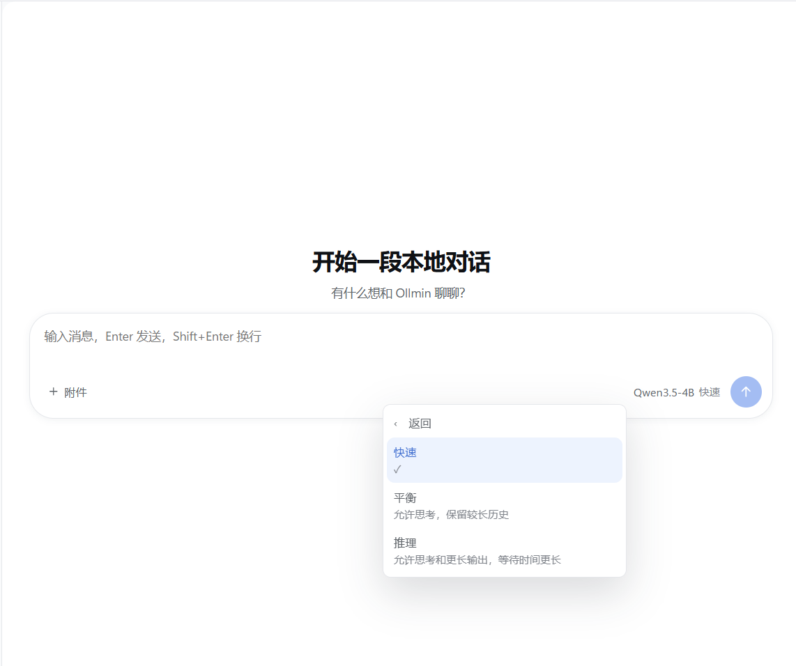
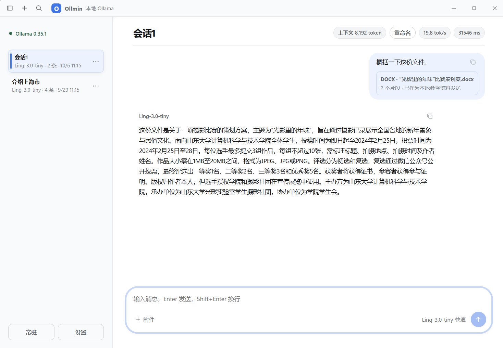

  <a href="README.md">English</a> | <a href="README.zh-CN.md">简体中文</a>

  <h1>Ollmin</h1>
  
<strong>Lightweight local AI for everyday PCs.</strong> 
  A fast Ollama desktop client optimized for CPUs, integrated graphics, and small local models.

  

    <a href="https://github.com/lincux0/ollmin/releases/download/v1.2.0/Ollmin_1.2.0_x64-setup.exe"><strong>Download for Windows (v1.2.0)</strong></a>
    &nbsp;·&nbsp;
    <a href="https://github.com/lincux0/ollmin/releases">View all releases</a>
  

  
Windows 10/11 · Local &amp; private · No account · MIT

  

More screenshots: performance modes, local file questions, and settings

**Performance modes**

**Local file questions**

**Settings**

## Why Ollmin?

- Lightweight for low-end PCs, CPUs, integrated graphics, and limited memory;
- Designed for small local models, including 3B and 4B-class models;
- Local model support: Ollmin connects to Ollama on your own PC; downloaded local models need no account;
- Local PDF, DOCX, XLS, and XLSX parsing for file questions;
- A compact per-turn summary of generation speed and elapsed time;
- A focused Windows desktop app that avoids unnecessary context and background model requests.

## Features

- Fast, Balanced, and Reasoning modes with bounded context and output settings;
- A single Ollama chat request at a time, with stop controls and separate thinking/answer display;
- Local conversation history in SQLite, with search, rename, restore, delete, and export;
- File excerpts selected for the current question instead of sending an entire document;
- Clear connection status, request state, and stop feedback.
- A resizable chat layout, title-bar session search, reading anchors and user-turn navigation;
- Four-section settings with theme/chat-font previews, explicit save/cancel and recoverable errors.

Model speed depends on the model, quantization, context, and hardware. The modes configure requests to Ollama; they do not guarantee a particular inference speed.

## Ollmin and general-purpose AI clients

| | Ollmin | General-purpose AI clients |
| --- | --- | --- |
| Focus | Small local models and everyday PCs | Broader feature sets |
| Backend | Ollama | Multiple providers, depending on the client |
| Account | Not required | Varies |
| Telemetry | None | Varies |
| File processing | Local parsing for supported formats | Varies |
| Main goal | Lightweight, predictable local chat | Feature breadth |

## Quick start for users

1. [Download the Windows installer](https://github.com/lincux0/ollmin/releases/download/v1.2.0/Ollmin_1.2.0_x64-setup.exe) and install Ollmin.
2. Install and start [Ollama](https://ollama.com/), then make sure at least one model is available. For example, run <code>ollama pull qwen3:4b</code>.
3. Open Ollmin, select the local model and a performance mode, then start a conversation.

You do not need Node.js, Rust, or Tauri to use the installer. Ollmin connects to Ollama at <code>127.0.0.1:11434</code>.

## Performance modes

| Mode | Ollama request settings | Good for |
| --- | --- | --- |
| Fast | Thinking off, 4K context, up to 2,048 output tokens; trims history by complete turns | Short questions and low-resource PCs |
| Balanced | Thinking on, 4K context, up to 768 output tokens | Everyday conversations |
| Reasoning | Thinking on, 8K context, up to 2,048 output tokens | More involved questions |

These are request settings, not performance promises. Model loading, quantization, processor, memory bandwidth, and prompt length affect generation speed.

## Local file support

Attach up to three local files at a time, each up to 20 MiB: PDF, DOCX, XLS, or XLSX. Ollmin parses supported text and spreadsheet cell values locally, then includes bounded relevant excerpts in the question sent to your local Ollama service.

- Original files are not uploaded or copied into Ollmin's data directory.
- Parsed excerpts and attachment metadata are saved in the local conversation database so an attachment can be restored with its conversation.
- Scanned/image-only PDFs are not OCR'd. Legacy Word <code>.doc</code> files are not supported; save them as DOCX first.

## Benchmark / Performance

No reproducible Ollmin benchmark results are published yet. Generation speed varies with model, quantization, context, and hardware; Ollmin UI overhead has not been measured separately.

## How it works

Ollmin parses selected files and stores conversations locally. Chat requests go from the Windows app to the Ollama service on the same PC.

    Ollmin desktop app
      ├─ Local file parsing and bounded excerpt selection
      ├─ Local SQLite conversation history
      └─ HTTP to 127.0.0.1:11434
             └─ Ollama and your local model

## Privacy and local data

- Ollmin connects only to <code>127.0.0.1:11434</code>. With downloaded local models, inference runs on your PC. Ollama can also route cloud models through its local service; choose a downloaded local model to keep inference local. See [Ollama Cloud](https://docs.ollama.com/cloud).
- No account, telemetry, cloud sync, or background model requests.
- Conversations and settings are stored at <code>%APPDATA%\com.ollmin.desktop\ollmin.sqlite3</code>.
- Parsed attachment excerpts and metadata are stored as plaintext in that local database; original files and source paths are not stored.
- Thinking content is not saved unless you enable it in Settings. Exports happen only when you request them.

## Build from source

For development, use Windows 10/11, Node.js 20+, the Rust stable toolchain, Tauri 2 prerequisites, and a running local Ollama service.

    git clone https://github.com/lincux0/ollmin.git
    cd ollmin
    npm ci
    npm run tauri -- dev

Run the checks used by the repository's CI:

    npm run test
    npm run build
    cargo fmt --manifest-path src-tauri/Cargo.toml -- --check
    cargo test --manifest-path src-tauri/Cargo.toml

The v1.2.0 Windows installer is attached to the [GitHub Release](https://github.com/lincux0/ollmin/releases/tag/v1.2.0). Source build commands are for developers.

## FAQ

### Ollama is disconnected

Start Ollama and check its local endpoint:

    Invoke-RestMethod http://127.0.0.1:11434/api/version

Ollmin uses this local address and does not switch to a remote server automatically.

### Why does the Debug build open a terminal?

Debug builds keep a console visible for Rust logs. The Release build hides the Windows console.

### Where is my local data stored?

The SQLite database is at <code>%APPDATA%\com.ollmin.desktop\ollmin.sqlite3</code>. Parsed file excerpts and metadata are stored there to restore attachments in saved conversations.

### What are the current limitations?

Scanned PDFs need OCR in another app before use, and legacy <code>.doc</code> files must be saved as DOCX. Generation speed depends on the local model and hardware. Ollmin 1.2.0 does not include automatic updates or a full desktop end-to-end test workflow.

## Documentation

- [Architecture](docs/ARCHITECTURE.md)
- [Development and builds](docs/DEVELOPMENT.md)
- [Testing and validation](docs/TESTING.md)
- [Technical decisions](docs/DECISIONS.md)

## Contributing

Bug reports and focused feature ideas are welcome. If Ollmin fits your workflow, a star helps more people find it:

- [Report a bug](https://github.com/lincux0/ollmin/issues/new?template=bug_report.md)
- [Request a feature](https://github.com/lincux0/ollmin/issues/new?template=feature_request.md)
- [Contributing guide](CONTRIBUTING.md)
- [Security policy](SECURITY.md)
- [Pull requests](https://github.com/lincux0/ollmin/pulls)

## Current status

The latest published release is v1.2.0. Installer signing, automatic updates, and full desktop end-to-end coverage are not included in this release. New features should preserve Ollmin's local-first design and avoid unnecessary model requests or context.

## License

Ollmin is licensed under the MIT License. See [LICENSE](LICENSE).
