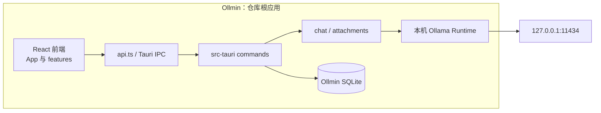

# 当前架构

本文描述 Ollmin `1.2.0` 的当前实现。产品方案、阶段计划和验证记录见 `docs/` 下对应文档。

## 产品与模块关系



Ollmin 由仓库根目录的 React 前端、Tauri 命令入口和本地 SQLite 数据库组成；所有模型请求由 Rust 后端转发到本机 Ollama。

## Ollmin 请求与数据流

1. `src/App.tsx` 组合会话、模型、设置和聊天界面；`src/api.ts` 封装 Tauri IPC，`src/contracts/ipc.ts` 定义前后端共享形状。
   `src/features/shell/WindowTitleBar.tsx` 独立拥有窗口控制和最大化状态订阅；`theme.ts` 应用显式或系统主题并释放监听，`Icon.tsx` 复用原有图标。此层不参与聊天调度或持久化。主题与壳层的阶段规格和实测边界见 [UI重构验证](UI-REFACTOR-VALIDATION.md)。
   `SessionSidebar.tsx` 拥有搜索展开和行菜单表现，App 保留150ms去抖查询与代次隔离、会话动作及草稿确认；`ChatWorkspace.tsx` 管理共享正文轴和拖宽。`useSidebar.ts` 管理1024px断点、折叠和264–420px拖宽；`components/ui/MenuSurface.tsx`、`Modal.tsx` 通过portal与顶层浮层栈管理定位、键盘及焦点。几何偏好使用 `ollmin.ui.sidebar.width`、`ollmin.ui.sidebar.collapsed`、`ollmin.ui.chatWidth`；localStorage失败不阻断启动，不进入SQLite业务设置。
2. `src-tauri/src/commands.rs` 注册命令并装配应用状态；`chat.rs` 校验请求、准备历史、执行 NDJSON 流、取消活动请求并生成指标事件。
3. `attachments.rs` 协调 PDF、DOCX、XLS/XLSX 解析和受限上下文；`file_security.rs` 处理本地文件边界。
4. `platform/runtime.rs` 通过固定的 `http://127.0.0.1:11434` 访问 Ollama。专用 HTTP 客户端绕过系统代理且不跟随重定向。前端不直接请求 Ollama。
5. `storage.rs` 使用 SQLite 保存会话、消息、设置和附件解析数据，数据库位于 `%APPDATA%\com.ollmin.desktop\ollmin.sqlite3`；当前 schema 版本为 9。

```text
src/App.tsx → src/api.ts → Tauri invoke
                         → commands.rs → chat.rs → platform/runtime.rs → Ollama
                                       ↘ storage.rs → ollmin.sqlite3
```

## 目录职责

| 路径 | 职责 |
| --- | --- |
| `src/` | React 主界面、共享 UI、功能组件、IPC 契约和聊天工具函数 |
| `src-tauri/src/commands.rs` | Tauri 命令、应用启动及状态装配 |
| `src-tauri/src/chat.rs` | 性能档位、历史、聊天流、停止、事件和诊断 |
| `src-tauri/src/attachments.rs`、`attachment_*.rs` | 本地附件解析与引用上下文 |
| `src-tauri/src/platform/` | Ollmin 使用的本机 Ollama Runtime 与协议契约 |
| `src-tauri/src/storage.rs` | SQLite schema 迁移、会话/设置存取与导出 |
| `docs/adr/` | 产品边界、网络运行时和数据分类等正式决策记录 |

## 关键边界

聊天顶部只显示22px会话标题，模型/性能入口集中在输入区右侧。顶部栏新建按钮右侧提供搜索按钮，点击或Ctrl+K展开侧栏搜索；点击搜索区域外清空查询并收起，Escape返回顶部搜索按钮焦点。侧栏不再重复显示新建按钮或“本地会话”，上下24px/左右20px。回合摘要使用前10个Unicode码点，超出追加“……”，保持横向单行。右上上下文/指标与重命名为28px扁圆控件；会话卡片/菜单沿用设置9px圆角。模型菜单宽280px，只显示别名或未设别名的原名，搜索与发送仍使用既有真实模型标识。正文透明拖宽区域保留，不显示悬浮长竖线。

阶段5设置由 `features/settings/SettingsDialog.tsx` 承载外观、模型与性能、会话与隐私、本机服务与关于四类；App继续拥有业务设置草稿与原有保存接口。主题和12–22px会话字号可预览，放弃恢复已保存值；字号仅作用于消息/思考/代码/输入，使用 `ollmin.uiFontSize` 本机UI偏好，不修改SQLite。保存同步防重并冻结关闭；字号写入失败不提交业务设置，业务保存失败恢复旧字号并保留编辑。初始化期间隐藏未就绪内容，在显示前应用主题；共享Modal恢复可见焦点，嵌套关闭不抢另一层焦点。

阶段4由 `useChatReading` 统一拥有底部72px跟随、可见消息锚点和当前回合；常驻message-stack、ResizeObserver与布局effect在输入、宽度及思考高度变化时恢复锚点。TurnNavigator只导航已加载用户消息，阅读区边缘空间不足时隐藏轨道，回到最新仍可用；逐token正文不使用live region。MessageItem保持对象memo边界及手动思考开合，正文、问题、思考、围栏代码分别复制，失败不显示成功。基础Markdown仍为安全React节点和链接白名单，没有高亮/公式或新依赖。

阶段3聊天输入由 `features/chat/Composer.tsx` 常驻承载，Hero/底部通过 `ChatWorkspace` 的阶段样式切换；textarea和滚动容器不因空态或会话加载重新挂载。App拥有草稿、模型、档位、附件及请求状态，初始化/会话加载使用settling布局，输入高度变化仅在跟随消息时滚到底部。

`ModelPicker.tsx` 复用MenuSurface，右侧提供模型/性能二级菜单，左侧提供性能快捷入口，两者修改同一App状态。模型超过4个时搜索真实名称和别名，发送仍使用真实模型名；启动加载设置后应用默认模型，手动有效选择不再被默认值覆盖。模型目录错误与离线分别反馈，刷新代次隔离旧结果；只在既有刷新或用户重试时请求目录。

Composer负责输入法合成、重复Enter、同步提交防重、附件上限和解析门禁；App再以活动请求及连接/模型状态校验发送。停止及迟到事件隔离沿用既有后端和请求ID契约，未新增IPC、SQLite迁移或依赖。

- Ollmin 只访问本机 Ollama，不提供远程服务地址、账号、云端 API 或遥测。
- 本机接口不保证模型一定在本机推理；使用已下载的本地模型时保持本地推理，Ollama 云端模型仍可能经本地服务转发到云端。
- 快速模式关闭思考、限制上下文和输出，并按完整轮次裁剪历史；单个活动请求可被显式停止。
- 模型输出不会被当作命令执行；Markdown 通过 React 节点渲染，不插入原始 HTML。
- 思考内容默认不保存；附件原文件和源路径不保存，但解析片段与元数据会以明文保存在本地 SQLite 中。
- 会话导出由用户显式触发，数据保存在 Ollmin 的本地数据库中。

实现细节和验证入口见 [DEVELOPMENT.md](DEVELOPMENT.md)、[TESTING.md](TESTING.md)；历史设计取舍见 [DECISIONS.md](DECISIONS.md)。
