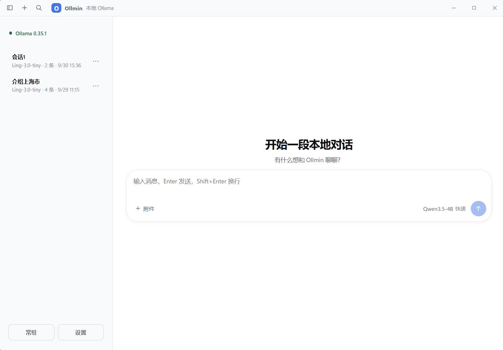
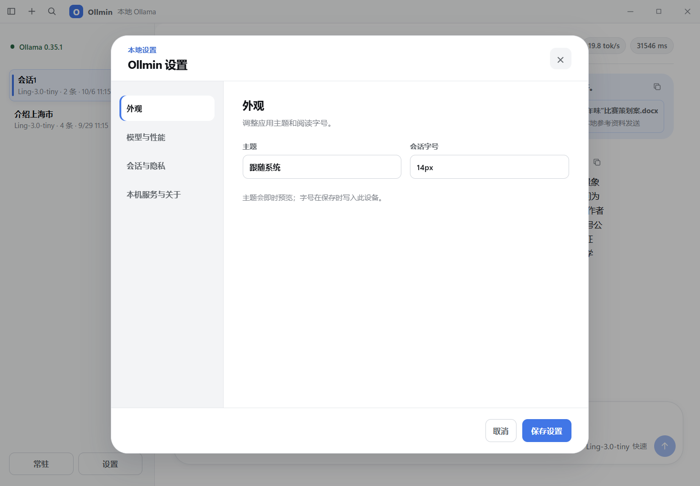

# 我开源了 Ollmin：给本地小模型一个轻量、顺手的 Windows 桌面界面

在 Windows 上用 Ollama 跑本地模型，下载模型、打开终端，就能开始对话。但如果想把它用在日常工作中，比如整理文字、概括文档、回看之前的问题，一个顺手的桌面界面会方便很多。

我开源了一个叫 **Ollmin** 的项目：面向普通 PC 和本地小模型的轻量 Ollama 桌面客户端。

它把重点放在几件具体的事情上：方便地聊天、控制上下文和输出预算、查看本地文件，以及保存和查找历史会话。

目前公开版本为 **v1.2.0**，提供 Windows x64 安装包，采用 MIT 许可证。

- [GitHub 源码仓库](https://github.com/lincux0/ollmin)
- [版本说明与安装包](https://github.com/lincux0/ollmin/releases/tag/v1.2.0)

## 一、先看看界面



打开 Ollmin 后，左侧是本机会话，主区域用于阅读和输入，模型与性能模式入口放在输入框旁边。

选择本机已经安装的模型，就可以开始对话。发送使用 Enter，换行使用 Shift＋Enter；需要参考文件时，可以通过附件入口添加。

Ollmin 使用 **Tauri 2＋Rust＋React＋TypeScript** 构建，连接固定的本机 Ollama 地址：

```text
http://127.0.0.1:11434
```

使用发行版安装包，无需自行安装 Node.js、Rust 或搭建开发环境。Ollama 和模型需要另外安装。

## 二、为本地小模型控制请求预算

本地模型的体验，除了取决于模型本身，也受上下文长度、思考过程和输出长度影响。尤其是在资源有限的电脑上，每次都带入大量历史，并不一定适合当前问题。

Ollmin 提供了三种模式：


| 模式 | 使用思路 |
|---|---|
| 快速 | 默认关闭思考，控制上下文与输出预算，适合简短问答和文字处理 |
| 平衡 | 允许支持思考的模型进行思考，适合日常交流 |
| 推理 | 提供更大的默认上下文与输出预算，适合需要更多分析的问题 |

快速模式还会按完整对话轮次裁剪历史，尽量避免把所有旧消息持续塞进新请求。

这些模式配置的是发给 Ollama 的请求参数。**实际速度仍取决于模型、量化方式、硬件和问题长度。** Ollmin 目前没有发布可复现的性能基准，因此这里也不承诺“低配秒回”或固定的提速幅度。

对于已经能在自己电脑上运行的小模型，可以从快速模式开始，再根据任务调整。

## 三、把本地文件带进对话

除了直接聊天，Ollmin 也支持本地文件问答。目前可添加的格式包括：

- PDF
- DOCX
- XLS
- XLSX

一次最多添加三个文件，单个文件不超过 20 MiB。

下面是一个 DOCX 文件概括示例：


添加文档后，可以直接询问“概括一下这份文件”，也可以进一步提出具体问题，例如：

> 请列出这份方案中的时间安排和参与要求。

Ollmin 会在本机解析文件，并根据问题选取有限的相关片段，加入发往本机 Ollama 的请求。这样可以控制文件内容占用的上下文。

这项功能有明确边界：**扫描件或图片型 PDF 不提供 OCR，旧版 Word `.doc` 文件暂不支持。** 扫描件需要先识别文字，`.doc` 则可以先另存为 DOCX。

文件问答的准确性还取决于解析结果、片段选择和模型能力。涉及日期、金额、条款等关键内容时，仍应回到原文核对。

截图顶部显示的是该次对话的生成指标，仅用于说明界面如何呈现耗时和速度，不代表其他电脑、模型或任务的表现。

## 四、聊天记录留在本机，也方便回头找

日常使用 AI，很容易遇到一个问题：前几天问过的内容，今天又需要翻出来。

Ollmin 使用 SQLite 保存本机会话，支持搜索、重命名、恢复、删除，以及导出 Markdown 或 JSON。顶部搜索入口也可以通过 **Ctrl＋K** 打开。

阅读较长对话时，可以使用用户回合导航定位之前的问题，并快速回到最新内容。生成过程支持停止；对于支持思考的模型，思考和正文分开展示，也能分别复制。

这些功能围绕同一个目标：让本地聊天可以持续使用，而不只是完成一次临时问答。

## 五、主题和字号可以自己调整



设置分为外观、模型与性能、会话与隐私、本机服务与关于四个部分。

可以选择浅色、深色或跟随系统主题，也可以调整会话字号。修改时能够预览效果，再选择保存或取消。

如果经常阅读模型生成的长段文字，合适的字号和主题会比增加更多按钮更实用。

## 六、本地使用，也要把数据边界说清楚

Ollmin 不要求账号，没有遥测和云同步，客户端只连接本机 Ollama。**使用已下载的本地模型时，聊天推理在自己的电脑上进行。**

这里需要区分客户端地址和模型实际运行位置：Ollama 也支持云端模型，经本机服务调用云端模型时，推理仍可能发生在云端。希望保持本地使用的用户，应选择已经下载到本机的模型。[Ollama 官方云端模型说明](https://docs.ollama.com/cloud)

会话和设置保存在本机数据库中：

```text
%APPDATA%\com.ollmin.desktop\ollmin.sqlite3
```

思考内容默认不保存，只有在设置中明确开启后才会保存。为了恢复会话附件，解析出的文件片段和元数据也会以明文保存在本地数据库中；原始文件及源文件路径不保存在该数据库里。

“保存在本地”也意味着需要自己管理这台电脑上的数据。处理敏感文件前，建议先了解这些保存行为。

## 七、如何开始使用

首先，安装并启动 [Ollama](https://ollama.com/download/windows)。当前官方 Windows 文档要求 Windows 10 22H2 或更新版本，具体驱动与环境要求可以查看[官方说明](https://docs.ollama.com/windows)。

然后下载一个适合自己电脑的本地模型。例如，项目 README 使用下面的命令作为示例：

```powershell
ollama pull qwen3:4b
```

下载完成后，可以查看模型列表：

```powershell
ollama list
```

接着从 [Ollmin Release 页面](https://github.com/lincux0/ollmin/releases/tag/v1.2.0)下载并安装：

```text
Ollmin_1.2.0_x64-setup.exe
```

打开 Ollmin，确认 Ollama 已连接，选择模型和模式，就可以开始聊天。

如果显示未连接，先确认 Ollama 已启动，也可以在 PowerShell 中检查本机接口：

```powershell
Invoke-RestMethod http://127.0.0.1:11434/api/version
```

目前 Ollmin 安装包尚未签名，也没有自动更新功能。后续版本需要从 Release 页面手动下载。

## 八、欢迎试用，也欢迎一起完善

Ollmin 适合想在 Windows 上使用本地小模型、保存聊天记录，以及进行简单文件问答的用户。

项目还在持续完善。欢迎试用，也欢迎提交明确的功能建议或问题报告。如果遇到异常，附上系统版本、硬件配置、Ollama 版本、模型完整名称和复现步骤，会更方便定位。

开发者可以从源码开始：

```powershell
git clone https://github.com/lincux0/ollmin.git
cd ollmin
npm ci
npm run tauri -- dev
```

源码开发需要 Node.js、Rust 和 Tauri 2 的 Windows 前置环境，详细说明见[中文 README](https://github.com/lincux0/ollmin/blob/main/README.zh-CN.md)。

如果这个项目刚好符合你的需求，欢迎点一个 Star，帮助更多使用本地模型的人发现它。

**项目地址：[https://github.com/lincux0/ollmin](https://github.com/lincux0/ollmin)**
